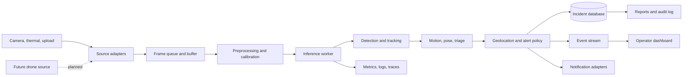

# Rescue-Eye Product Requirements Document

## 1. Product Summary

Rescue-Eye is a computer-vision decision-support system for search-and-rescue teams. It analyzes live or recorded video, detects people, maintains identities across frames, estimates motion and posture, assigns a triage priority, and presents actionable alerts on a map and operations dashboard.

The product assists trained responders. It must never represent an automated score as a confirmed medical diagnosis or replace human command decisions.

## 2. Current Progress

The repository already contains a working proof of concept:

- `main.py` orchestrates six sequential phases: detection, tracking, motion, pose, triage, and geo output.
- `detection/human_detector.py` loads a YOLO person detector from `models/yolov8n.pt`.
- `tracking/tracker.py` uses DeepSORT to create track IDs.
- `motion/motion_analyzer.py` estimates movement using optical flow.
- `pose/pose_analyzer.py` uses MediaPipe when available and falls back to bounding-box heuristics.
- `triage/severity_scorer.py` produces LOW, MEDIUM, and HIGH rule-based results.
- `geo/geo_mapper.py` writes victim candidates to JSON using simulated coordinates.
- `dashboard/app.py` provides local Streamlit views for dashboard, upload, analysis, map, victims, reports, and settings.
- The pipeline writes annotated video, a geo snapshot, and JSON run history.
- Optional Arduino LED alerts are already wired into the pipeline.

The current implementation is a local, single-process demonstration. It is not yet production-ready because it has no durable database, authenticated users, live multi-source ingestion, real camera calibration, model evaluation suite, service API, deployment packaging, observability, or field-safety controls.

The current project scope does not include drone operations. Drone ingestion and aerial workflows are planned for a future release after the fixed-camera and uploaded-video workflows are validated.

The first executable target is a Windows CPU-compatible recorded-video workflow. An NVIDIA GPU is an optional acceleration path, not a prerequisite for development, testing, or local MVP operation.

## 3. Product Goals

### Primary goals

1. Detect likely people in difficult rescue scenes with high recall.
2. Keep a stable identity for each person within a source stream.
3. Produce explainable triage observations using posture, motion, confidence, and temporal evidence.
4. Show responders where an observation came from and how fresh it is.
5. Continue operating with degraded connectivity and clearly indicate stale data.
6. Preserve an auditable record of detections, operator decisions, and notifications.
7. Make model and threshold changes measurable before field use.

### Non-goals for the first complete release

- Drone capture, drone ingestion, autonomous flight, navigation, and collision avoidance; drone support is planned for a future release.
- Phone/IP-camera live streaming; the current CLI accepts local video paths only. Live URL input is planned for Operational v1.
- Automatic medical diagnosis or treatment recommendations.
- Identity recognition, face recognition, or biometric matching.
- Fully autonomous dispatch of rescue teams.
- A custom thermal-fusion model before a representative paired dataset exists.

## 4. Users and Core Workflows

### Incident commander

- Creates or selects an incident.
- Sees active cameras, latest victim observations, system health, and alert priority.
- Acknowledges, assigns, escalates, resolves, or dismisses alerts.
- Reviews the evidence behind a triage score.

### Search operator

- Opens a live or recorded source.
- Reviews bounding boxes, track history, posture, motion, and confidence.
- Marks an observation as confirmed victim, false positive, or needs review.
- Adds a note and optional field location correction.

### System administrator

- Registers cameras and sensors.
- Configures model versions, thresholds, retention, notification channels, and user roles.
- Checks service, device, storage, and inference health.

### ML or operations engineer

- Runs reproducible evaluation jobs.
- Compares model versions and threshold configurations.
- Reviews false positives and false negatives from labeled incidents.
- Promotes a model only after approval and rollback readiness.

## 5. Product Scope by Release

### Release 0: Engineering foundation

- Add a dependency lockfile and documented Python version.
- Provide one supported Windows CPU installation path and one optional NVIDIA CUDA installation path.
- Add a runtime device setting with `cpu` as the deterministic default and `cuda` as an opt-in value after verification.
- Separate pipeline orchestration, domain models, storage, and presentation code.
- Add structured logging, configuration from environment or YAML, and stable output schemas.
- Add unit tests for motion, pose fallback, severity scoring, geo mapping, history handling, and CLI validation.
- Add a reproducible smoke test using a short fixture video or mocked detector.
- Add linting, formatting, type checking, and CI.
- Define license, data handling policy, threat model, and model-card template.

### Release 1: Complete local MVP

- Process uploaded video from the dashboard.
- Keep the proven local entry points executable: `python main.py --setup-check`, `python main.py --phase phase6`, and `streamlit run dashboard/app.py`.
- Support local video files in `.mp4`, `.avi`, `.mov`, `.mkv`, and `.webm` formats; reject unsupported or unreadable media with an actionable error.
- Store incidents, runs, observations, and operator decisions in SQLite or PostgreSQL instead of append-only JSON as the system of record.
- Keep JSON export for interchange and offline reports.
- Replace simulated map coordinates with a documented camera calibration interface; retain simulation only as an explicit demo mode.
- Provide an operator alert lifecycle: new, acknowledged, assigned, resolved, dismissed.
- Add evidence links to the source timestamp and annotated frame or clip.
- Add health and error states for missing model weights, unavailable optional dependencies, corrupt media, and failed outputs.

### Release 2: Operational v1

- Ingest multiple RTSP, file, and webcam sources through a source manager.
- Add phone/IP-camera URLs only through the source-manager adapter; do not pass URLs directly to the current `Path`-based CLI.
- Add per-source timestamps, camera metadata, buffering, reconnect, and store-and-forward behavior.
- Expose a versioned REST API and WebSocket or server-sent event feed for alerts.
- Add authentication, role-based access control, audit logging, encrypted transport, and configurable retention.
- Add notification adapters for email, SMS, webhook, and field-team integrations.
- Package the API, worker, dashboard, database, and message broker with Docker Compose.
- Add deployment runbooks for an edge device and a central command node.

### Release 3: Multi-modal and field validation

- Add thermal source ingestion and calibration against RGB cameras.
- Fuse RGB and thermal evidence only when timestamps and spatial calibration are valid.
- Future drone capability: add aerial video and GPS/IMU metadata ingestion after fixed-camera validation.
- Validate in controlled drills before any operational use.
- Optimize inference for the selected edge hardware and measure latency, throughput, and thermal behavior.

### Release 4: Scale and learning loop

- Add dataset import, annotation review, and hard-example queues.
- Track model, dataset, code, and configuration versions for every result.
- Add offline replay benchmarks and canary model deployment.
- Consider anomaly detection only after the core detection and alert workflow meets its reliability targets.

## 6. Functional Requirements

### 6.1 Incident and source management

- The system shall create an incident with name, location, start time, commander, retention policy, and status.
- The system shall register a source with source type, URI or upload identity, camera location, timezone, calibration status, and health state.
- The system shall support file playback in the MVP and RTSP ingestion in operational v1.
- Every frame and observation shall carry a source ID and capture timestamp when available.
- A source failure shall be visible to operators and shall not silently appear as an empty scene.

### 6.2 Detection and tracking

- The detector shall support a configured model path and confidence threshold.
- The default model shall be treated as a baseline, not as a certified rescue model.
- The tracker shall expose track ID, bounding box, confidence, first seen, last seen, and source ID.
- Track IDs shall be scoped to a source and run; cross-camera identity matching is out of scope for Release 1.
- The system shall retain low-confidence candidate evidence for evaluation without automatically escalating every candidate.

### 6.3 Motion, pose, and triage

- Motion and pose modules shall be independently enabled or disabled.
- Disabled or unavailable modules shall emit an explicit status and reason rather than silently producing equivalent confidence.
- Triage results shall include score, severity, evidence fields, model or rule version, and timestamp.
- A result shall be marked as an observation until it meets configurable temporal confirmation rules.
- Operators shall be able to override severity and record the reason.
- The UI shall show that triage is an assistance signal and not a medical conclusion.

### 6.4 Geolocation

- The system shall distinguish simulated, calibrated, and GPS-derived coordinates.
- Simulated coordinates shall never be labeled as exact victim locations.
- Calibrated mapping shall record camera calibration version and coordinate reference system.
- A map marker shall link to source, timestamp, bounding box, confidence, and evidence media.
- Operators shall be able to correct a location and preserve the original automated value.

### 6.5 Alerts and workflow

- Alerts shall be deduplicated by incident, source, track, and configurable time window.
- Alert status shall support new, acknowledged, assigned, resolved, and dismissed.
- High-priority alerts shall include a reason, confidence, last-seen time, source, and location status.
- Notifications shall be retried with bounded backoff and show delivery status.
- Every alert transition and operator action shall be audit logged.

### 6.6 Dashboard

- The dashboard shall provide an incident overview, source health, active alerts, map, video or evidence view, victim list, reports, and settings.
- Operators shall be able to filter by severity, source, time, status, and confidence.
- The dashboard shall display loading, empty, stale, error, and offline states.
- The dashboard shall not imply that a missing observation means no person is present.
- Reports shall export incident summaries, alert history, evidence references, and pipeline configuration.

## 7. Target Architecture



Recommended service boundaries:

- `api`: incident, source, alert, user, report, and configuration endpoints.
- `worker`: media decoding, preprocessing, inference, tracking, triage, and evidence generation.
- `dashboard`: operator interface consuming the API and event stream.
- `storage`: PostgreSQL for metadata, object storage for video and evidence, and Redis or a queue for work distribution.
- `evaluation`: offline replay and metric calculation, kept separate from production inference.

The existing Python modules can remain the first implementation of the worker domain, but the dashboard should stop importing pipeline internals and reading JSON files directly once the API is introduced.

## 8.1 Executable Implementation Contract

The following contract defines what must work at each stage. Every command must be run from the repository root, `F:\Repositories\Rescuer\rescuerer`, using the selected virtual environment's Python executable.

### Current repository smoke path

After dependencies and model weights are installed, these commands are the initial acceptance path:

```powershell
python main.py --setup-check
python main.py --phase phase6
streamlit run dashboard\app.py
```

The default command discovers a supported local video under `data\` and uses the default model at `models\yolov8n.pt`. A clean checkout must first be given a documented sample video and model asset because those binary files are intentionally not stored in Git. The smoke path shall produce an annotated output video, `data\phase6_geo_snapshot.json`, and an entry in `data\pipeline_history.json`. The dashboard shall start without requiring a live camera, drone, database, or cloud service.

### Environment requirements

- Supported development host: Windows 10 or Windows 11.
- Supported Python version: one version pinned by the future lockfile; until then, verify the chosen version against Ultralytics and MediaPipe before documenting it as supported.
- Required runtime packages: PyTorch, Ultralytics, OpenCV, NumPy, DeepSORT dependency, MediaPipe, Streamlit, Folium, Plotly, Pandas, and any packages imported by the dashboard.
- Required local asset: `models\yolov8n.pt`.
- Optional tool: `ffmpeg` for browser-compatible video transcoding.
- Optional hardware: NVIDIA GPU with a compatible driver and CUDA-enabled PyTorch build.

### CPU and GPU behavior

- CPU mode shall be the baseline for correctness tests and shall work without `nvidia-smi`, CUDA, or an NVIDIA driver.
- GPU mode shall be selected only after a verification command reports `torch.cuda.is_available() == True`.
- The application shall print the selected device, model path, input path, output path, processed frame count, and elapsed time at the end of every run.
- CPU mode may process fewer frames per second, but it shall produce the same output schema and must not silently skip frames or downgrade triage semantics.
- FP16, batch inference, ONNX, and TensorRT are optimization work, not installation prerequisites or MVP acceptance criteria.

### Installation contract

The project shall provide a committed `requirements.txt` or `pyproject.toml` and a lock strategy before Release 0 is complete. The documented baseline must be executable with commands of this form:

```powershell
py -3 -m venv .venv
.\.venv\Scripts\python.exe -m pip install --upgrade pip
.\.venv\Scripts\python.exe -m pip install -r requirements.txt
.\.venv\Scripts\python.exe main.py --setup-check
```

The optional CUDA instructions shall be separate from the baseline and shall use the PyTorch wheel index appropriate to the verified driver/runtime combination. The PRD shall not hard-code CUDA 11.8 as the only supported choice.

### Executability gates

- A fresh Windows virtual environment passes `main.py --setup-check` after the documented model asset is present.
- A deterministic fixture or mocked detector, stored outside Git when binary, permits CI to run without downloading a model, opening a GUI window, using an Arduino, or requiring a GPU.
- An integration test processes a short local video and checks that the output video, geo JSON, and history JSON are valid.
- The dashboard starts in an empty-data state and does not crash when no source video, output video, or history file exists.
- Any command that depends on `ffmpeg`, CUDA, a camera URL, or Arduino hardware checks availability and reports a remediation message.
- No PRD milestone is considered complete until its commands are run on a clean environment and their expected artifacts are verified.

## 8. Data Contracts

Every persisted entity shall include an immutable ID, incident ID, source ID where applicable, created timestamp, and schema version.

Minimum entities:

- `Incident`: status, location, owner, retention policy, created and closed timestamps.
- `Source`: type, name, connection metadata, calibration, health, last frame timestamp.
- `PipelineRun`: source, input reference, model version, configuration, status, timing, error.
- `Track`: run, source, track ID, first and last seen, lifecycle status.
- `Observation`: track, timestamp, box, posture, motion, severity, confidence, evidence reference, provenance.
- `Alert`: observation aggregate, priority, status, assignee, delivery state, operator notes.
- `AuditEvent`: actor, action, entity, before and after values, timestamp, request ID.

The API shall use stable JSON schemas and explicit units. Coordinates shall identify their coordinate reference system. Confidence values shall be in the range 0 to 1.

## 9. Quality and Performance Targets

Targets must be validated on a held-out, representative rescue dataset and reported by scenario, not only as one aggregate number.

### Initial release targets

- Smoke test completes successfully on a clean environment with one documented command.
- At least 80 percent unit test coverage for deterministic domain logic; model wrappers require mocked tests plus a small integration test.
- No unhandled crash for missing optional hardware, missing weights, invalid media, or interrupted processing.
- P95 time from completed frame inference to dashboard event is under 2 seconds on the target edge hardware.
- A restarted worker resumes or marks interrupted runs without corrupting prior incident data.
- Every displayed alert can be traced to source, frame time, pipeline run, model version, and evidence.

### Model evaluation targets

- Report person recall, precision, mAP, false alerts per hour, and latency by lighting, occlusion, distance, camera type, and scene type.
- Report track continuity, IDF1 or equivalent, and track fragmentation.
- Report posture and triage confusion matrices, calibration, and abstention rate.
- Set go or no-go thresholds with rescue-domain reviewers before field trials; do not invent production thresholds from the current demo video.

## 10. Security, Privacy, and Safety

- Require authenticated access outside local development.
- Use least-privilege roles and audit all alert and configuration changes.
- Encrypt transport and sensitive stored media.
- Define retention and deletion rules for raw video, evidence clips, and audit records.
- Blur or avoid storing bystander identity data unless operationally necessary.
- Validate all uploaded media and restrict filesystem access to approved storage paths.
- Treat model outputs as untrusted signals; provide human confirmation and visible uncertainty.
- Add an emergency disable switch for notifications and hardware actuators.
- Document drone, radio, aviation, privacy, and local emergency-response requirements before field deployment.

## 11. Testing and Validation Plan

1. Unit tests for each deterministic module and dataclass contract.
2. Component tests with mocked YOLO, DeepSORT, MediaPipe, camera, notification, and Arduino dependencies.
3. End-to-end replay test using a short fixture video and golden output schema.
4. API tests for authentication, alert lifecycle, deduplication, retries, and audit events.
5. Dashboard tests for upload, filtering, stale state, error state, and report export.
6. Performance tests on the actual target edge device.
7. Controlled rescue-drill validation with labeled volunteers or mannequins and documented consent.
8. Failure drills for power loss, camera disconnect, queue backlog, corrupted media, database outage, and network loss.

## 12. Delivery Plan

### Milestone 1: Baseline and contracts

Deliver the environment setup, dependency lock, configuration model, schemas, logging, test harness, and CI. Exit when a clean checkout can run the smoke test and produce validated artifacts.

### Milestone 2: Hardened local MVP

Deliver the database-backed run model, explicit demo geolocation mode, alert lifecycle, evidence references, dashboard error states, and local deployment. Exit when an operator can process a video, review an alert, acknowledge it, and export a report.

### Milestone 3: Operational single-site deployment

Deliver API separation, RTSP source management, reconnect and buffering, authentication, audit logs, notifications, metrics, Docker packaging, and runbooks. Exit after a controlled drill with measured latency and failure recovery.

### Milestone 4: Multi-modal validation

Deliver calibrated thermal and GPS metadata support, paired-data evaluation, edge optimization, and field acceptance criteria. Exit only after safety and rescue-domain review.

### Milestone 5: Learning and scale

Deliver annotation feedback, dataset and model registry, replay benchmarks, canary deployment, and multi-incident operations. Add advanced models only when they improve validated metrics and operational decisions.

## 13. Risks and Mitigations

| Risk | Mitigation |
| --- | --- |
| False negatives in rubble, smoke, or occlusion | Optimize for recall, collect representative data, use temporal evidence, and show uncertainty. |
| False alarms overwhelm responders | Deduplicate alerts, require persistence, expose evidence, and support human confirmation. |
| Simulated coordinates are mistaken for real locations | Make coordinate provenance mandatory and visually explicit. |
| Model behavior changes unnoticed | Version models and configs, replay benchmark data, and require promotion approval. |
| Connectivity loss causes blind spots | Edge buffering, stale indicators, reconnect logic, and clear source health. |
| Privacy or unauthorized access | Authentication, encryption, retention controls, redaction, and audit logs. |
| Hardware or actuator failure | Optional integrations, watchdogs, health checks, and manual disable controls. |
| Limited rescue data | Controlled drills, consented collection, public datasets, synthetic augmentation, and active learning. |

## 14. Definition of Done for a Complete Project

Rescue-Eye is complete for its first operational release when:

- A clean checkout can be installed and started from documented commands.
- A user with the correct role can create an incident, register a source, process or stream media, and observe system health.
- The system produces versioned detections, tracks, triage observations, alerts, evidence, and provenance records.
- An operator can acknowledge, assign, resolve, dismiss, correct, and export alert information.
- The system survives expected input, dependency, network, and storage failures with visible states and recoverable runs.
- Automated tests and CI protect the core pipeline and API.
- Performance, accuracy, privacy, and safety evidence has been reviewed against agreed acceptance criteria.
- Deployment, rollback, backup, retention, incident response, and field-operations runbooks exist.
- The project clearly labels demo-only capabilities, especially simulated geolocation and unvalidated model behavior.